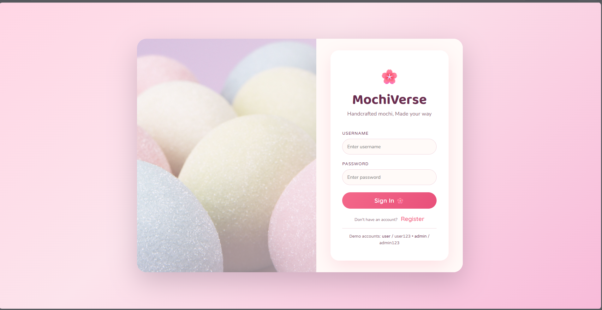
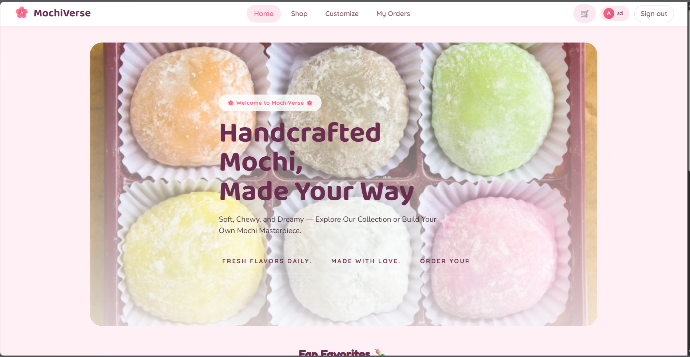
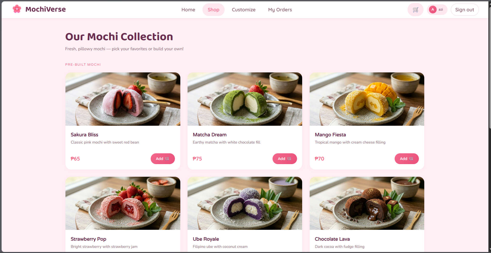
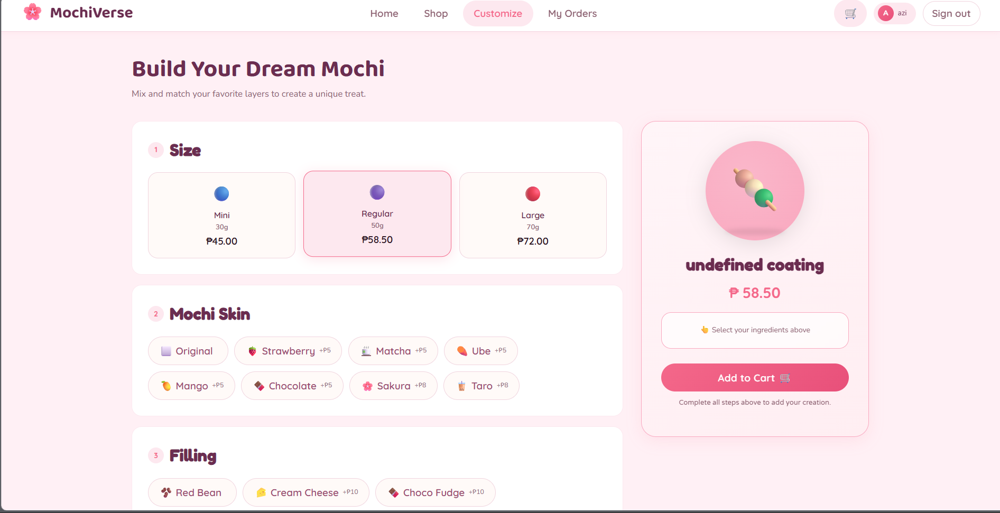

# 🌸 MochiVerse

**Handcrafted mochi, made your way.** MochiVerse is a playful, responsive storefront demo for browsing mochi flavors, building a custom treat, and placing sample orders. It also includes an admin view for managing the demo catalog and order statuses.

> **Demo project:** MochiVerse runs entirely in the browser. It does not use a production backend, persistent database, or payment provider. Accounts, orders, and catalog changes are temporary and reset when the page is refreshed. Do not use real customer information or passwords.

## 📚 Table of Contents

- [ Overview](#-overview)
- [ Screenshots](#-screenshots)
- [ Features](#-features)
- [ Built With](#-built-with)
- [ Getting Started](#-getting-started)
- [ Demo Accounts](#-demo-accounts)
- [ How to Use](#-how-to-use)
- [ Project Structure](#-project-structure)
- [ Notes and Limitations](#-notes-and-limitations)

## ✨ Overview

MochiVerse is a front-end shopping experience for a fictional mochi shop. Customers can explore the flavor collection, customize a mochi, add items to a cart, and submit a sample delivery or pickup order. An admin demo account provides a dashboard for reviewing orders and editing the product catalog.

The interface is built with HTML, CSS, and vanilla JavaScript. SQL.js creates an in-memory SQLite database in the browser and seeds it with the sample products.

## 🖼️ Screenshots

The screenshots below are included in [`assets/images`](assets/images/).

### 🔐 Sign In



### 🏠 Home



### 🍡 Product Collection



### 🎨 Mochi Customizer



## 🛍️ Features

### 👤 Customer Experience

- Browse featured items and the full mochi flavor collection.
- Build a custom mochi by choosing a skin, filling, coating, and size.
- Add pre-built and custom treats to a cart.
- Place sample delivery or pickup orders.
- View order history for the current browser session.

### 🛠️ Admin Demo

- Review orders and basic order statistics.
- Move orders through pending, preparing, ready, and delivered statuses.
- Add, edit, and remove products from the sample catalog.

## 🧰 Built With

- **HTML5** for page structure
- **CSS3** for responsive styling and visual design
- **Vanilla JavaScript** for app behavior
- **SQL.js** for an in-browser SQLite database
- **Bootstrap 5** for responsive layout utilities
- **Google Fonts** for typography

Bootstrap, SQL.js, and Google Fonts are loaded from external CDNs, so an internet connection is required when opening the app.

## 🚀 Getting Started

### ✅ Prerequisites

- A modern web browser
- A local static web server (recommended)
- An internet connection for the external libraries and fonts

### ▶️ Run Locally

1. Download or clone this project and open its folder.
2. Start a static server from the project root. For example, with Python installed:

   ```bash
   python -m http.server 8000
   ```

   Alternatively, use the **Live Server** extension in Visual Studio Code and select **Open with Live Server** on `index.html`.

3. Visit **http://localhost:8000** in your browser when using the Python server.
4. Sign in with one of the [demo accounts](#-demo-accounts).

Serving the files over HTTP is recommended because the app loads SQL.js and its WebAssembly file from a CDN.

## 🔑 Demo Accounts

| Role | Username | Password |
| --- | --- | --- |
| Customer | `user` | `user123` |
| Admin | `admin` | `admin123` |

The registration form can create additional customer accounts for the current page session. Refreshing the page resets registered accounts.

## 🧭 How to Use

### 🛒 Shop and Place an Order

1. Sign in as the customer demo account or register a temporary account.
2. Browse flavors from **Home** or **Shop**.
3. Add a pre-built mochi, or open **Customize** and select the available options.
4. Open the cart, review your items, and select **Confirm Order**.
5. Enter a name and Philippine mobile number, then choose delivery or pickup. A delivery address is required for delivery orders.
6. Select **Place Order** to add the sample order to the in-browser order list.

### 📋 Manage Orders and Products

1. Sign in as the admin demo account.
2. Use **Orders** to review sample orders and advance their statuses.
3. Use **Products** to add a catalog item or edit and remove existing items.

## 🗂️ Project Structure

```text
MochiVerse/
├── assets/
│   ├── images/             # App screenshots shown in this README
│   ├── Mochi1.jpg          # Home-page showcase images
│   ├── Mochi2.jpg
│   ├── Mochi3.jpg
│   └── ...                 # Product and background imagery
├── index.html              # App markup and page sections
├── mochi.js                # Authentication, catalog, cart, and order logic
├── style.css               # Responsive styling
├── mochii-logo.png         # Browser and app icon
└── README.md
```

## 📝 Notes and Limitations

- The SQL.js database is created in memory and is not exported or saved. Refreshing the page resets products, registered accounts, and orders to their initial demo state.
- The cart is stored in `sessionStorage` for the current browser tab/session; it is not a durable shopping cart.
- Demo credentials and role checks are implemented in front-end JavaScript. They are for demonstration only and are **not secure authentication**.
- Orders are sample records only. The app does not send orders to a shop, process payments, or contact a delivery service.
